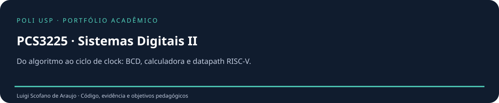

<p align="center"></p>

# PCS3225 · Sistemas Digitais II

**Do algoritmo ao ciclo de clock: BCD, calculadora e datapath RISC-V.**

[](https://github.com/luigiscofano/usp-pcs3225-sistemas-digitais/actions/workflows/verificacao.yml)

Portfólio de **Luigi Scofano de Araujo · Engenharia de Computação, Poli-USP · USP 13680334**. Organização e complementos de 2026 com assistência de IA, distinguindo acervo recuperado e implementações novas. [Procedência](docs/PROCEDENCIA.md).

## Objetivos pedagógicos em destaque

- **Relacionar algoritmo e FSM** — Traçar add-3 e shift de 42.
- **Definir handshake** — Manter start até done e liberar a próxima operação.
- **Separar controle e dados** — Identificar ROM, ULA e registerfile.
- **Decodificar instruções** — Reconstruir imediatos I/S/B/U/J.
- **Detectar operação ilegal** — Executar word inválido e load desalinhado.
- **Distinguir simulação e FPGA** — Reproduzir testbenches.

**[Atividades, evidências e rubrica →](docs/OBJETIVOS_PEDAGOGICOS.md)**

## Execute e experimente

```sh
python scripts/verificar.py
python scripts/figuras.py
# Opcional, em ambiente gráfico:
gtkwave build/double_dabble.vcd
```

Ambiente: **SystemVerilog 2012, Icarus Verilog 12+ e Python 3.12**. [Instalação detalhada](docs/INSTALACAO.md).

## Encontre cada parte

| Diretório | Conteúdo |
| --- | --- |
| [rtl/](rtl/README.md) | Módulos de hardware agrupados por experimento. |
| [rtl/double_dabble/](rtl/double_dabble/README.md) | Corretores add-3 e conversor sequencial parametrizado. |
| [rtl/calculadora/](rtl/calculadora/README.md) | ROM, banco de registradores, ULA e controle da demonstração. |
| [rtl/riscv/](rtl/riscv/README.md) | Gerador de imediatos e núcleo didático de subconjunto RV32I. |
| [tests/](tests/README.md) | Testbenches autochecking, timeout e falha por $fatal. |
| [scripts/](scripts/README.md) | Compilação, simulação e renderização do traço. |
| [assets/](assets/README.md) | FSM e forma de onda gerada de VCD real. |
| [docs/](docs/README.md) | Arquitetura, objetivos, reprodução, apresentação e evidência |

## Verificação e limites

1.005 conversões W18; 256 conversões W8 exaustivas; reset e handshake; programa 5+7 da calculadora; programa RV32 com memória, branches, saltos, ULA, x0 e traps. Cobertura por cenários, sem certificação ISA.

Sem síntese Quartus, placa ou pinagem; calculadora com ISA nova e ROM editável; RV32I apenas subconjunto declarado; sem prova formal ou cobertura completa de instruções.

**[Validação →](docs/VALIDACAO.md)** · **[Arquitetura e decisões →](docs/ARQUITETURA.md)**

Use o [roteiro de apresentação](docs/APRESENTACAO.md) e confira os [PRs reais](docs/PUBLICACAO.md). As branches representam organização atual, sem datas retroativas ou revisões fictícias.

[Contribuir](CONTRIBUTING.md) · [Direitos e créditos](DIREITOS_E_CREDITOS.md) · [Referências](docs/REFERENCIAS.md) · [Mudanças](CHANGELOG.md)

**CI confirmada:** [testes aprovados](https://github.com/luigiscofano/usp-pcs3225-sistemas-digitais/actions/runs/41227733916). Consulte o registro de [validação remota](docs/validacao-remota.json).
