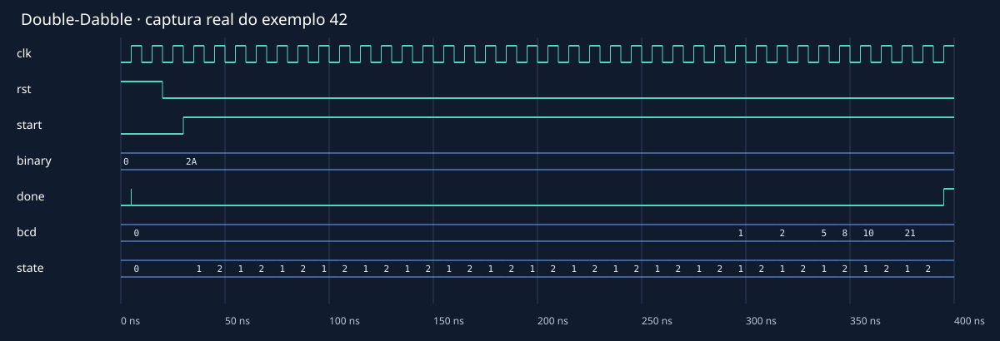

# Forma de onda real

[Início](../README.md) · [Como executar](../README.md#como-executar) · [Aprendizagem](../README.md#o-que-desenvolvi-e-aprendi) · [Estado atual](../README.md#estado-atual)

> **Nesta área:** figuras e evidências visuais; imagens ilustrativas e resultados de execução devem ser distinguidos conforme a legenda.

[Início](../README.md) · [Como executar](../README.md#como-executar) · [Aprendizagem](../README.md#o-que-desenvolvi-e-aprendi) · [Estado atual](../README.md#estado-atual)

> **Nesta área:** figuras e evidências visuais; imagens ilustrativas e resultados de execução devem ser distinguidos conforme a legenda.

O SVG foi renderizado de uma captura VCD real, não desenhado como resultado presumido. Buses aparecem em hexadecimal; state 0/1/2/3 corresponde a INIT/CORRECT/SHIFT/WAIT. O BCD final 0x42 representa os dígitos decimais 4 e 2.

[Captura VCD para GTKWave](double_dabble_42.vcd). Reproduza com scripts/verificar.py e scripts/figuras.py. Não é uma captura de placa física.

---

**Projeto:** [PCS3225 · Double-Dabble, calculadora e RISC-V](../README.md). Consulte a raiz para os requisitos e o primeiro comando; este guia aprofunda a área `assets/`.

---

**Projeto:** [PCS3225 · Double-Dabble, calculadora e RISC-V](../README.md). Consulte a raiz para os requisitos e o primeiro comando; este guia aprofunda a área `assets/`.
