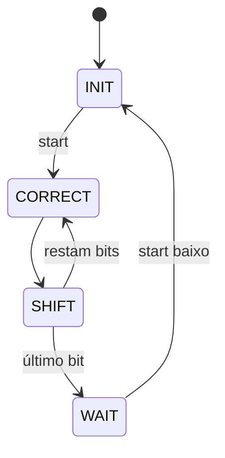

# Arquitetura, formatos e temporização

## Double-Dabble

O módulo usa W bits binários e `DIGITS=floor(W·30103/100000)+1`. W=8 e W=18 são os parâmetros testados; W=18 gera seis dígitos BCD. Não se afirma validação para parâmetros arbitrariamente grandes. Cada nibble ≥5 recebe três antes de deslocar o próximo bit da entrada.

Reset síncrono zera estado, acumulador e contador. Start captura binary uma vez. São 2W bordas de clock de CORRECT/SHIFT após a captura. WAIT mantém done e resultado enquanto start está alto. Baixar start retorna a INIT; depois disso pode-se iniciar outra operação.

O controle de estados e o caminho de dados estão separados conceitualmente e agrupados no módulo sequencial; corretores add3or0 são instâncias independentes. Não se afirma que há dois arquivos UC/FD autônomos quando a implementação não os separa fisicamente.

## Calculadora: ISA nova desta edição

Datapath de 32 bits, 16 registradores e ROM 32×16. Formato normal: opcode(4), rd(4), ra(4), rb(4). Todos os registradores são graváveis.

| Opcode | Operação | Semântica |
| --- | --- | --- |
| 0 | HALT | Trava done e preserva estado |
| 1 | LI | rd recebe imediato de oito bits com sinal |
| 2 | ADD | rd=ra+rb, conservando 32 bits baixos |
| 3 | SUB | rd=ra−rb |
| 4 | AND | rd=ra AND rb |
| 5 | OR | rd=ra OR rb |
| 6 | XOR | rd=ra XOR rb |
| 7–15 | Não implementado | fault persistente |

No imediato os oito bits baixos não são endereços de fontes. A ROM demonstra r1=5, r2=7, r3=r1+r2 e HALT. Para outro programa nesta versão, edite o módulo ROM e simule novamente; não há carregamento em tempo de execução. A tabela antiga de opcodes não foi recuperada e esta ISA não é apresentada como a original.

## RISC-V: subconjunto RV32I

Implementados: ADDI, ADD, SUB, AND, OR, XOR, LW, SW, BEQ, BNE, LUI, AUIPC, JAL e JALR. Não há ISA completa, extensões, CSRs, privilégios, interrupções, pipeline ou cache. Não é um núcleo certificado RV32I.

| Formato | Composição do imediato |
| --- | --- |
| I | extensão de sinal de inst[31:20] |
| S | extensão de sinal de {inst[31:25],inst[11:7]} |
| B | extensão de sinal de {inst[31],inst[7],inst[30:25],inst[11:8],0} |
| U | {inst[31:12],12 zeros} |
| J | extensão de sinal de {inst[31],inst[19:12],inst[20],inst[30:21],0} |

x0 é imutável. Aritmética conserva 32 bits baixos. LW/SW exigem endereço alinhado a quatro bytes; PC e destinos de saltos tomados também. JALR limpa bit zero antes da checagem. Instrução ilegal ou desalinhamento ativa trap persistente e desabilita escritas; reset libera execução. O barramento é combinacional, sem wait states. O ambiente deve prover memória e seus limites; o testbench fiscaliza sua memória de 128 bytes.

## Ferramentas e placa

Icarus compila os testbenches; vvp executa; VCD registra sinais; GTKWave permite inspecioná-los. A figura publicada é renderizada do VCD real do exemplo 42. Não foram inventados pinos FPGA. Placa requer escolha de dispositivo, clock, reset, constraints, síntese e análise de timing, etapas não executadas nesta validação.
